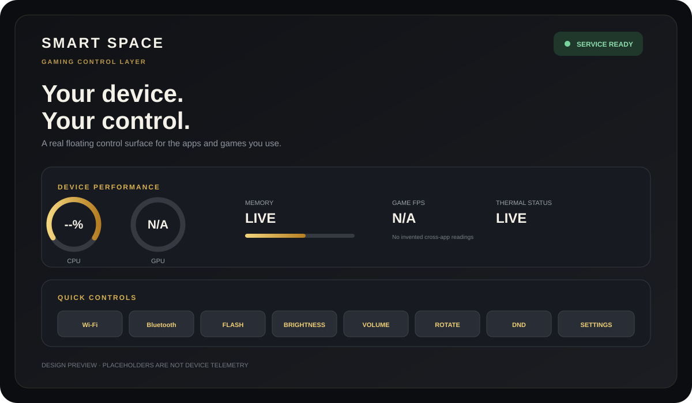

<div align="center">


# SMART SPACE
### V3.0.0 · FLOATING GAMING CONTROL LAYER

**A movable vertical dock. A live rectangular dashboard. Real device tools.**

[](#platform)
[](#architecture)
[](https://github.com/CFSTUDIO-project/Smart-Space-/actions)
[](LICENSE)

[Source](https://github.com/CFSTUDIO-project/Smart-Space-) · [Builds](https://github.com/CFSTUDIO-project/Smart-Space-/actions) · [Issues](https://github.com/CFSTUDIO-project/Smart-Space-/issues)

</div>

---

## V3 interface

Smart Space V3 uses a two-part floating interface inspired by a gaming control layer:

- **Vertical dock:** switch between Performance and Tools, and launch selected installed apps.
- **Rectangular dashboard:** displays current CPU/GPU readings, session time, battery level, display refresh rate and verified device telemetry.
- **Full-panel option:** hide the dock and use a single wide control panel.
- **Movable surface:** drag the panel title to move the complete floating surface; drag the lower-right grip to resize it.
- **Movable edge handle:** drag the thin vertical handle to any reachable screen position. Its coordinates are saved.
- **Responsive sizing:** panel width and height adapt to portrait and landscape dimensions.

### Control symbol library


### Interaction flow


The diagrams below are design references, not screenshots of a running device or sample performance measurements.




## What the dashboard reports

| Reading | Source / behavior |
|---|---|
| CPU load | Aggregate `/proc/stat` counters when readable |
| GPU load | Vendor/kernel telemetry paths when readable |
| CPU / GPU clock | Standard cpufreq/devfreq nodes when visible |
| RAM used | Android ActivityManager memory information |
| Battery | Android battery status broadcast |
| Battery temperature | Android battery temperature value; not CPU/GPU temperature |
| Thermal status | Android thermal API where supported |
| Session time | Time since the Smart Space foreground service started |
| Display refresh rate | Current display mode refresh rate reported by Android |
| Game FPS | `N/A` unless a real per-game source becomes available; never guessed |

## Tools

| Tool | Actual behavior |
|---|---|
| Wi-Fi | Opens Android Internet connectivity panel (API 29+) or Wi-Fi settings |
| Bluetooth | Opens Android Bluetooth settings |
| Flashlight | CameraManager torch action; requires Camera permission and flash hardware |
| Rotation | Opens Android display settings; it is not presented as a direct toggle |
| Do Not Disturb | NotificationManager after Notification Policy Access is granted |
| Battery | Opens Android power/battery settings |
| Brightness | Changes the system brightness after WRITE_SETTINGS declaration and user-granted special access |
| Volume | Adjusts the media stream with AudioManager |
| App shortcuts | Launches Chrome, TikTok, WhatsApp and YouTube only when installed and available |

No fake "Monster", "Boost", or frame-rate mode is included. Smart Space does not claim to change GPU clocks, unlock game FPS, or bypass Android power policies.

## Settings

The app Settings page includes:

- Dual Panel or Full Panel layout
- Dock on the left or right (Dual Panel)
- Panel opacity
- Show/hide installed app shortcuts
- Reset saved edge-handle and panel positions
- Overlay and device permission review
- Device battery/background settings

Changes to layout are applied the next time the floating panel is opened.

## Fixes in V3

- Rebuilt the overlay as an explicit dock + dashboard container.
- Gave the panel, ScrollView and content host explicit transparent/dark backgrounds to avoid the blank gray content region.
- Moved panel dragging to the branded title area and persisted panel coordinates.
- Reworked edge-handle touch tracking with movement threshold and saved X/Y coordinates.
- Added separate Performance and Tools screens with actual controls and telemetry.
- Added a usable Settings page for layout, dock side, opacity, app shortcuts and resetting positions.
- Kept all unsupported readings explicit as unavailable.

## How to use

1. Install and open Smart Space.
2. Complete the AUTHORIZED guide and grant Display over other apps.
3. Activate Smart Space from the dashboard.
4. Drag the thin edge handle to reposition it, then tap to open the control layer.
5. Use the vertical dock to switch between Performance and Tools.
6. Drag the Smart Space title to move the full panel.
7. Use the resize grip at the bottom-right of the panel.
8. Close the panel to restore the edge handle.

## Permissions

| Access | Purpose |
|---|---|
| Display over other apps | Show the edge trigger and floating dashboard |
| Notifications | Foreground service notification on Android 13+ |
| Camera | Physical flash torch only |
| Modify System Settings | Brightness slider |
| Notification Policy Access | DND action |
| Battery settings | User reviews device power restrictions |
| Shizuku | Optional authorization foundation; no advanced shell commands are run |

Shizuku is not root. Smart Space currently checks its Binder connection and permission state; no privileged commands are executed.

## Android limits

Android provides a user-facing Internet panel through `Settings.Panel.ACTION_INTERNET_CONNECTIVITY`. Wi-Fi and Bluetooth are handled through system UI rather than fake in-app switches. Android overlay windows are managed with `WindowManager.LayoutParams.TYPE_APPLICATION_OVERLAY`; touch and drag behavior depends on the window receiving touch events and Android's overlay security rules.

The brightness action requires both `android.permission.WRITE_SETTINGS` in the manifest and user approval in Android Settings. The app checks the permission again when the AUTHORIZED page resumes.

## Platform

- Minimum Android: 8.0 (API 26)
- Compile SDK: 35
- Target SDK: 35
- Version: 3.0.0 (versionCode 4)
- Kotlin / native Android Views
- WindowManager application overlay
- User-started foreground service

OEM firmware can still impose additional overlay, background and power restrictions. A successful CI build confirms compilation, not device-specific runtime behavior.

## Build

Open [Android CI](https://github.com/CFSTUDIO-project/Smart-Space-/actions), choose the latest successful run and download `smart-space-debug-apk`.

Local build: JDK 17, Gradle 8.9, Android SDK Platform 35 and Build Tools 35.0.0.

```bash
gradle --no-daemon assembleDebug
```

APK output: `app/build/outputs/apk/debug/app-debug.apk`

## Repository structure

```text
.
├── .github/workflows/android.yml
├── app/src/main/
│   ├── AndroidManifest.xml
│   ├── java/com/cfstudio/smartspace/
│   │   ├── MainActivity.kt
│   │   ├── SpaceOverlayService.kt
│   │   └── DeviceMonitor.kt
│   └── res/drawable/
│       ├── ic_space.xml
│       └── ic_*.xml
├── assets/
│   ├── space-mark.svg
│   ├── control-symbols.svg
│   ├── space-flow.svg
│   ├── dashboard-preview.svg
│   ├── overlay-preview.svg
│   └── authorized-preview.svg
├── LICENSE
└── README.md
```

## Roadmap

- [x] Vector symbol system
- [x] Dual dock and dashboard layout
- [x] Full-panel layout option
- [x] Performance and device-tools screens
- [x] Draggable edge handle and panel title
- [x] Saved floating positions and reset action
- [x] Responsive portrait and landscape sizing
- [x] Settings for layout, dock side, opacity and shortcuts
- [ ] Runtime verification on Infinix Hot 60i
- [ ] Per-game profiles backed by real Android capabilities
- [ ] Additional OEM GPU telemetry adapters
- [ ] Accessibility and localization review

## Credits

<div align="center">

**Created by CFSTUDIO-project**

[**SEE MORE — Smart Space on GitHub ↗**](https://github.com/CFSTUDIO-project/Smart-Space-)

<sub>SMART SPACE V3.0.0 · REAL CONTROLS · HONEST TELEMETRY</sub>

</div>

## Official references

- [Android WindowManager.LayoutParams](https://developer.android.com/reference/android/view/WindowManager.LayoutParams)
- [Android application overlay windows](https://developer.android.com/reference/android/view/WindowManager.LayoutParams#TYPE_APPLICATION_OVERLAY)
- [Android Settings panels](https://developer.android.com/reference/android/provider/Settings.Panel)
- [Android WRITE_SETTINGS access](https://developer.android.com/reference/android/provider/Settings.System#canWrite(android.content.Context))
- [Android CameraManager torch API](https://developer.android.com/reference/android/hardware/camera2/CameraManager#setTorchMode(java.lang.String,boolean))
- [Shizuku API](https://github.com/RikkaApps/Shizuku-API)
