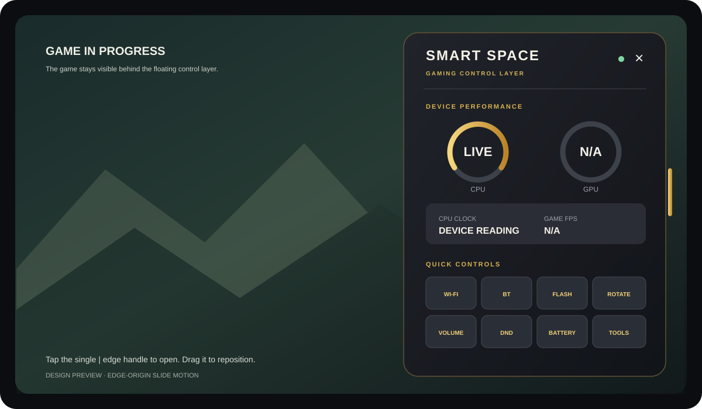
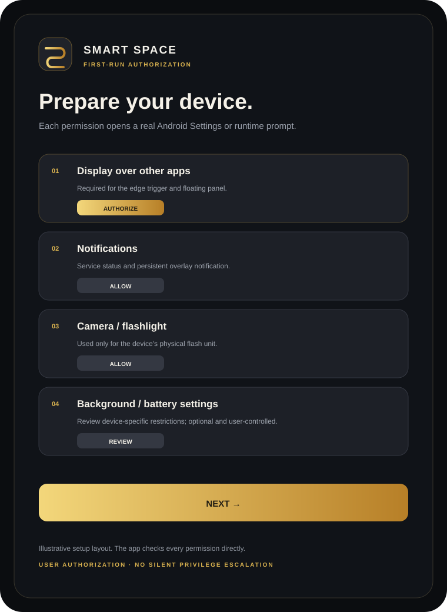

# SMART SPACE
### Gaming Control Layer for Android

**One slim edge trigger. One live control surface. Your device, honestly measured.**

[Explore the source](https://github.com/CFSTUDIO-project/Smart-Space-) · [Build history](https://github.com/CFSTUDIO-project/Smart-Space-/actions) · [Report an issue](https://github.com/CFSTUDIO-project/Smart-Space-/issues)

---

## The idea

Smart Space (SS) is an Android gaming companion built around a single, slim edge handle. Tap the handle to reveal a floating panel above the current app. Close the panel and it moves back toward the edge instead of blinking out of existence.

The visual language is deliberately restrained: deep charcoal surfaces, warm amber accents, clear type, compact controls and motion that communicates where the panel came from and where it goes.

> **No invented telemetry.** When Android or device firmware does not expose a metric, Smart Space reports it as unavailable instead of filling the screen with a believable-looking number.

## Visual direction

The following diagrams are hand-authored SVG previews of the product direction. They are design illustrations, not screenshots of an installed app and not live device readings.

### Dashboard · responsive portrait and landscape

### Floating window · edge-origin motion

### AUTHORIZED · permission-first setup

## Product principles

| Principle | How Smart Space applies it |
|---|---|
| Real controls | Use Android APIs where allowed, or open the relevant system panel. No decorative toggles. |
| Honest telemetry | CPU, memory and battery values are read from device sources. GPU is best-effort. Cross-app game FPS is unavailable where Android does not expose it. |
| Edge-first | One slim vertical | trigger opens the floating surface. No floating bubble or oversized shortcut. |
| Orientation-aware | Activity and overlay dimensions adapt to the current display in portrait and landscape. |
| User-authorized | Overlay, notifications, camera/torch and optional system access are explained before activation. |
| Respect Android | A foreground service keeps the user-enabled overlay available with a visible notification. Android can still apply background and power restrictions. |

## Feature status

| Feature | Status in this foundation | Details |
|---|---|---|
| Animated splash screen | Included | Logo and progress rail reveal |\n| Boot sequence | Included | Elapsed timer and verified overlay/service/window status |
| AUTHORIZED onboarding | Included | Permission checklist with real Android Settings and runtime prompts |
| Overlay permission | Included | Checks Android special overlay access |
| Notification permission | Included | Runtime request on Android 13+ |
| Camera / flashlight permission | Included | Torch action uses CameraManager where hardware supports it |
| Modify system settings | Included | Needed for the brightness control |
| Battery / background guidance | Included | Opens Android battery settings; no hidden exemption |
| Shizuku authorization | Included | Checks the live Shizuku Binder and requests genuine user authorization through the official API; no privileged commands are run yet |
| Slim vertical trigger | Included | Draggable edge handle with a 4dp visible line |
| Floating panel | Included | WindowManager application overlay |
| Enter / exit motion | Included | Slides in from and returns to the right edge |
| Panel move / resize | Included | Drag the title area to move; drag the lower-right grip to resize |
| Scrollable content | Included | Metrics, quick controls, sliders and app shortcuts |
| Portrait / landscape | Included | Overlay dimensions recalculate on orientation changes |
| Chrome / TikTok / WhatsApp / YouTube | Included | Only installed apps with launch activities are displayed |
| CPU usage | Best effort | Aggregate device CPU counters via /proc/stat when readable |
| RAM usage | Included | Android ActivityManager memory information |
| CPU clock | Best effort | Standard cpufreq sysfs nodes when readable |
| GPU usage / clock | Best effort | Common vendor sysfs nodes; depends on kernel and OEM |
| Battery / battery temperature | Included | Values reported by Android's battery service |
| Thermal status | Included | Android thermal status API on supported versions |
| Cross-app game FPS | Not available in this foundation | Never replaced with display refresh rate or a guessed value |
| Wi-Fi / Bluetooth | System hand-off | Opens Android connectivity controls; ordinary apps cannot freely toggle every radio on modern Android |
| Flashlight | Permission-gated | CameraManager torch mode, where available |
| Volume | Included | AudioManager music stream slider |
| Brightness | Permission-gated | Requires user-granted Modify System Settings access |

## How it works

1. Open Smart Space from the app launcher.
2. Complete the AUTHORIZED guide and grant Display over other apps.
3. Activate Smart Space from the dashboard.
4. The slim vertical handle appears above other apps.
5. Drag the handle to reposition it, or tap to open the floating panel.
6. The panel slides in from the right edge. Scroll to see more controls.
7. Drag the title area to move the panel, or the lower-right grip to resize it.
8. Tap close and watch the panel slide back out; the edge handle returns.

### Main app

- Premium animated opening screen
- AUTHORIZED setup guide with clear permission state
- Dashboard with activation status
- Settings for the floating panel
- About page with creator credit and SEE MORE repository link

### Floating experience

The overlay is created with Android WindowManager and TYPE_APPLICATION_OVERLAY. It can appear above normal app and game windows after the user grants overlay access. Android can still place critical system UI above it, block overlays over protected/secure surfaces, or restrict the service under device power policies.

## Permission guide

Smart Space does not silently grant itself privileged access.

| Access | Why it is requested | User action |
|---|---|---|
| Display over other apps | Draw the trigger and panel over games/apps | Enable Smart Space in Android overlay access settings |
| Notifications | Show active service status | Runtime permission on Android 13+ |
| Camera | Turn on the physical flash as a torch | Runtime permission; only used by the flashlight action |
| Modify system settings | Change screen brightness from the panel | Grant special access in Android Settings |
| Battery optimization | Review background restrictions | Open Android battery settings; exemption is optional |
| Shizuku | Optional advanced access | Install and start Shizuku separately, then authorize Smart Space through Shizuku's real permission dialog |

### Shizuku is not root

Shizuku can provide shell/ADB identity on a non-rooted device or root identity when the device is configured for root. Its capabilities depend on the server being started and the permissions available on that Android version. The current Smart Space foundation uses the official API to check the Binder connection and request user authorization. It does not execute shell commands or claim root access. Installing Shizuku alone does not start its service or grant Smart Space permission.

## Telemetry: what the numbers mean

- **CPU load:** aggregate device CPU activity calculated from successive /proc/stat samples. If the kernel blocks the file or counters are invalid, the reading is unavailable.
- **RAM:** used and total device memory from ActivityManager.MemoryInfo.
- **CPU clock:** attempts standard cpufreq sysfs nodes. OEMs may hide or rename them.
- **GPU load / clock:** attempts selected KGSL, devfreq and vendor telemetry nodes. Android devices do not share one universal GPU utilization interface.
- **Battery temperature:** the temperature reported by Android's battery service. It is not presented as CPU or GPU temperature.
- **Thermal status:** Android thermal status on supported versions.
- **Game FPS:** a normal app cannot automatically read the true frame rate of every unrelated game. Smart Space does not pretend that display refresh rate equals game FPS.

## Platform

- Minimum Android: 8.0 (API 26)
- Compile / target SDK: Android 15 (API 35)
- Language: Kotlin
- UI: native Android Views
- Overlay: WindowManager and TYPE_APPLICATION_OVERLAY
- Background presence: user-started foreground service with a visible notification

OEM firmware can impose additional restrictions. Some controls and metrics vary by device, kernel, Android release and permission state.

## Build the APK

A GitHub Actions workflow builds a debug APK on pushes and pull requests.

1. Open [Actions](https://github.com/CFSTUDIO-project/Smart-Space-/actions).
2. Select **Android CI**.
3. Open the latest run.
4. Download the **smart-space-debug-apk** artifact when the build succeeds.

Local build requirements: JDK 17, Gradle 8.9, Android SDK Platform 35 and Build Tools 35.0.0.

<pre>gradle assembleDebug</pre>

APK output: app/build/outputs/apk/debug/app-debug.apk

## Repository layout

<pre>
.
├── .github/workflows/android.yml
├── app/
│   ├── build.gradle.kts
│   └── src/main/
│       ├── AndroidManifest.xml
│       ├── java/com/cfstudio/smartspace/
│       │   ├── MainActivity.kt
│       │   ├── SpaceOverlayService.kt
│       │   └── DeviceMonitor.kt
│       └── res/
│           ├── drawable/ic_space.xml
│           └── values/styles.xml
├── assets/
│   ├── space-mark.svg
│   ├── dashboard-preview.svg
│   ├── overlay-preview.svg
│   ├── authorized-preview.svg
│   └── space-flow.svg
└── README.md
</pre>

## Roadmap

- [x] Native Android project foundation
- [x] Permission-first onboarding
- [x] Floating trigger and animated panel
- [x] Scroll and resize interactions
- [x] App discovery for the four requested apps
- [x] Device telemetry with explicit unavailable states
- [ ] Validate runtime behavior on Infinix Hot 60i
- [ ] Add individually-scoped advanced controls that use an authorized Shizuku connection only where the Android version and device support them
- [ ] Add per-game profiles and user-controlled auto-show rules
- [ ] Add session history and benchmark comparisons
- [ ] Expand OEM GPU telemetry adapters
- [ ] Final accessibility, localization and polish pass

## Credits

**Created by CFSTUDIO-project**

Smart Space is an independent open-source Android project. This repository is the canonical place for source code, build history, documentation and issue tracking.

[**SEE MORE — Explore Smart Space on GitHub ↗**](https://github.com/CFSTUDIO-project/Smart-Space-)

Built with care. Measured with honesty.

## Research references

- [Android application overlay windows](https://developer.android.com/reference/android/view/WindowManager.LayoutParams#TYPE_APPLICATION_OVERLAY)
- [Overlay access settings](https://developer.android.com/reference/android/provider/Settings#ACTION_MANAGE_OVERLAY_PERMISSION)
- [Foreground service background-start restrictions](https://developer.android.com/develop/background-work/services/fgs/restrictions-bg-start)
- [Foreground service type requirements](https://developer.android.com/about/versions/14/changes/fgs-types-required)
- [Wi-Fi manager restrictions](https://developer.android.com/reference/android/net/wifi/WifiManager#setWifiEnabled(boolean))
- [Android settings panels](https://developer.android.com/reference/android/provider/Settings.Panel)
- [Camera torch API](https://developer.android.com/reference/android/hardware/camera2/CameraManager#setTorchMode(java.lang.String,boolean))
- [Shizuku API and developer guide](https://github.com/RikkaApps/Shizuku-API)
- [Shizuku API on Maven Central](https://central.sonatype.com/artifact/dev.rikka.shizuku/api)

SMART SPACE · SS · ANDROID GAMING CONTROL LAYER

