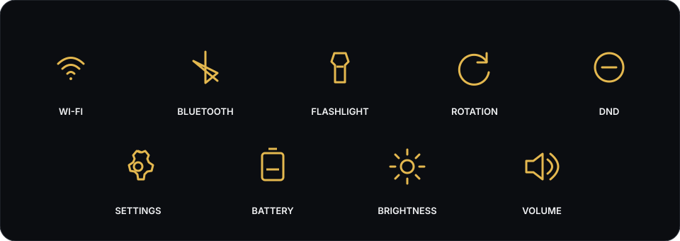
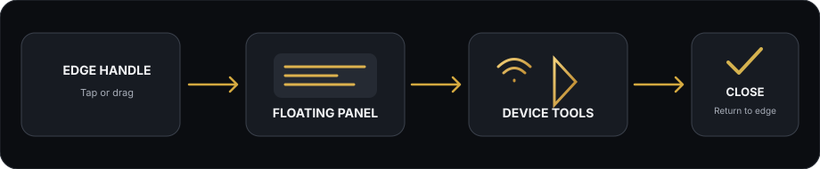

<div align="center">


# SMART SPACE
### V2.0.0 · GAMING CONTROL LAYER FOR ANDROID

**A clean edge trigger. A live control surface. Device tools with real permissions.**

[](#platform)
[](#architecture)
[](https://github.com/CFSTUDIO-project/Smart-Space-/actions)
[](LICENSE)

[Source](https://github.com/CFSTUDIO-project/Smart-Space-) · [Builds](https://github.com/CFSTUDIO-project/Smart-Space-/actions) · [Issues](https://github.com/CFSTUDIO-project/Smart-Space-/issues)

</div>

---

## V2 direction

Smart Space (SS) is a native Android companion built around a slim vertical edge handle. Tap it to reveal a floating control panel above the app you are using. The panel can be moved, resized, scrolled and dismissed back to the edge.

V2 refines the control language with a consistent set of **vector-drawn symbols**. Wi-Fi, Bluetooth, flashlight, rotation, Do Not Disturb, battery, brightness, volume, settings, close and resize each use their own scalable Android drawable. The interface does not use emoji or font-dependent pictographs for control icons.

### Visual language

- Deep charcoal surfaces with restrained amber highlights
- Consistent 24dp vector symbols with accessible content descriptions
- Compact tiles, clear section dividers and readable touch targets
- Motion that communicates the panel's edge origin and return path
- Responsive layout for portrait and landscape

### Control symbol set



### Interaction flow



### Dashboard and setup concepts

These hand-authored diagrams show the intended interface structure. They are design previews, not screenshots of a running app or claims of device measurements.


## Product principles

| Principle | Implementation |
|---|---|
| Real controls | Android APIs are used where allowed; restricted actions hand off to the appropriate system screen |
| Honest telemetry | CPU, memory and battery use device sources; GPU is best effort; unavailable readings remain N/A |
| Edge-first | A slim vertical `|` handle opens the floating panel; no bubble launcher |
| Orientation-aware | Activity and overlay dimensions adapt to portrait and landscape |
| User-authorized | Special access and runtime permissions are explained before use |
| No fake performance | Cross-app game FPS is never inferred from refresh rate or invented |

## V2 control map

| Symbol | Control | Behavior |
|---|---|---|
| Wi-Fi | Internet | Opens Android's Internet connectivity panel on supported versions |
| Bluetooth | Bluetooth settings | Opens Android Bluetooth settings; ordinary target-33+ apps cannot directly switch the adapter |
| Flashlight | Camera torch | Uses CameraManager after Camera permission, when a flash is available |
| Rotation | Display settings | Opens Android display settings to manage auto-rotate |
| DND | Do Not Disturb | Uses NotificationManager after Notification Policy Access is granted |
| Settings | System settings | Opens Android Settings |
| Battery | Battery settings | Opens the device battery/power settings |
| Brightness | Screen brightness | Uses the system brightness setting after Modify System Settings access |
| Volume | Media volume | Uses AudioManager for the music stream |
| Close | Panel | Animates the panel out and restores the edge handle |
| Resize | Panel size | Drag the lower-right grip to resize the panel |

## Feature status

| Feature | Status | Notes |
|---|---|---|
| Animated splash | Included | Brand mark and animated progress rail |
| AUTHORIZED onboarding | Included | Permission state is checked using Android APIs |
| Overlay trigger | Included | Thin, draggable vertical handle |
| Floating panel | Included | WindowManager application overlay |
| Open / close animation | Included | Slides from and returns to the edge |
| Move / resize / scroll | Included | Title drag, corner grip and scroll container |
| Portrait / landscape | Included | Overlay rebuilds after configuration changes |
| Installed app shortcuts | Included | Chrome, TikTok, WhatsApp and YouTube appear only when installed |
| CPU load / clock | Best effort | Depends on kernel visibility of standard counters |
| RAM | Included | ActivityManager memory information |
| GPU load / clock | Best effort | OEM and kernel dependent |
| Battery / temperature | Included | Android battery broadcast values |
| Thermal status | Included | Android thermal API where supported |
| Cross-app game FPS | Not available | No fabricated FPS value |
| Wi-Fi / Bluetooth | System hand-off | Android policy restricts direct toggling by ordinary apps |
| Flashlight / DND | Permission-gated | Uses CameraManager and NotificationManager |
| Brightness / volume | Included | Uses system settings access and AudioManager respectively |
| Shizuku | Authorization foundation | Detects Binder and requests permission; no privileged commands are run yet |

## How to use

1. Install and open Smart Space.
2. Complete the AUTHORIZED guide.
3. Grant Display over other apps to allow the edge trigger.
4. Grant optional permissions only for the controls you plan to use.
5. Activate Smart Space from the dashboard.
6. Tap the vertical handle to open the panel.
7. Drag the panel title to move it; drag the lower-right corner to resize.
8. Use the close control to return the panel to its edge position.

## Permission guide

| Access | Why it is requested |
|---|---|
| Display over other apps | Shows the edge trigger and panel above other apps |
| Notifications | Shows the active foreground-service notification on Android 13+ where requested |
| Camera | Turns the physical camera flash on as a torch; no photo capture feature is provided |
| Modify system settings | Allows the brightness slider to change the system screen brightness |
| Notification policy access | Allows the user-controlled Do Not Disturb action |
| Battery settings | Lets the user review OEM background restrictions; no hidden exemption is applied |
| Shizuku | Optional authorization foundation; the user starts Shizuku separately |

Smart Space does not silently grant itself access. Android permission screens remain in control, and optional permissions can remain disabled.

### Shizuku is not root

Shizuku can expose a service identity provided by its own server, depending on how the user starts it. The current Smart Space code checks the Shizuku Binder and requests the official permission grant. It does not execute shell commands or claim root access. Installing Shizuku alone does not start its service.

## Telemetry notes

- **CPU load:** calculated from successive aggregate `/proc/stat` samples when readable.
- **RAM:** used and total memory from `ActivityManager.MemoryInfo`.
- **CPU clock:** reads standard cpufreq nodes when exposed by the kernel.
- **GPU load / clock:** checks selected vendor paths; device support varies significantly.
- **Battery temperature:** reported by Android's battery service; it is not CPU or GPU temperature.
- **Thermal status:** provided by Android on supported versions.
- **Game FPS:** not available as a standard cross-app metric to an ordinary app. Smart Space does not use display refresh rate as a substitute.

## Android behavior and API limits

Wi-Fi and Bluetooth are intentionally handled through system UI. Android 10+ restricts ordinary apps from enabling or disabling Wi-Fi through `WifiManager.setWifiEnabled()`. For apps targeting Android 13+, `BluetoothAdapter.enable()` and `disable()` are deprecated and return `false` for ordinary apps. Smart Space therefore opens the user-facing system settings instead of showing a fake toggle.

The brightness action requires the user to grant Modify System Settings access. Volume uses the music stream through AudioManager. Do Not Disturb requires Notification Policy Access. Flashlight control requires camera permission and compatible flash hardware.

## Platform

- Minimum Android: 8.0 (API 26)
- Compile SDK: 35
- Target SDK: 35
- Language: Kotlin
- UI: Native Android Views
- Overlay: WindowManager with `TYPE_APPLICATION_OVERLAY`
- Background presence: user-started foreground service with a visible notification

OEM software may impose additional background, power and overlay restrictions.

## Build the APK

GitHub Actions builds a debug APK on pushes, pull requests and manual workflow runs.

1. Open [Android CI](https://github.com/CFSTUDIO-project/Smart-Space-/actions).
2. Select the latest successful run.
3. Download the `smart-space-debug-apk` artifact.

Build environment: JDK 17, Gradle 8.9, Android SDK Platform 35 and Build Tools 35.0.0.

```bash
gradle --no-daemon assembleDebug
```

APK output: `app/build/outputs/apk/debug/app-debug.apk`

## Repository layout

```text
.
├── .github/workflows/android.yml
├── app/
│   ├── build.gradle.kts
│   └── src/main/
│       ├── AndroidManifest.xml
│       ├── java/com/cfstudio/smartspace/
│       │   ├── MainActivity.kt
│       │   ├── SpaceOverlayService.kt
│       │   └── DeviceMonitor.kt
│       └── res/
│           ├── drawable/
│           │   ├── ic_space.xml
│           │   ├── ic_wifi.xml
│           │   ├── ic_bluetooth.xml
│           │   ├── ic_flashlight.xml
│           │   ├── ic_rotate.xml
│           │   ├── ic_dnd.xml
│           │   ├── ic_settings.xml
│           │   ├── ic_battery.xml
│           │   ├── ic_close.xml
│           │   ├── ic_brightness.xml
│           │   ├── ic_volume.xml
│           │   ├── ic_resize.xml
│           │   ├── ic_chip.xml
│           │   ├── ic_controls.xml
│           │   └── ic_apps.xml
│           └── values/styles.xml
├── assets/
│   ├── space-mark.svg
│   ├── control-symbols.svg
│   ├── space-flow.svg
│   ├── dashboard-preview.svg
│   ├── overlay-preview.svg
│   └── authorized-preview.svg
├── LICENSE
└── README.md
```

## Roadmap

- [x] Native Android project foundation
- [x] Permission-first onboarding
- [x] Floating edge trigger and animated panel
- [x] Move, resize and scroll interactions
- [x] Vector control-symbol library
- [x] V2 README and repository asset references
- [ ] Runtime validation on physical devices, including Infinix Hot 60i
- [ ] Implement carefully scoped Shizuku-backed features only where supported and explicitly authorized
- [ ] Per-game profiles and user-controlled auto-show rules
- [ ] Session history and benchmark comparisons
- [ ] Additional OEM GPU telemetry adapters
- [ ] Accessibility and localization review

## Credits

<div align="center">

**Created by CFSTUDIO-project**

Smart Space is an independent open-source project. The repository is the canonical location for source code, build history, documentation and issues.

[**SEE MORE — Smart Space on GitHub ↗**](https://github.com/CFSTUDIO-project/Smart-Space-)

<sub>Built with care. Measured with honesty.</sub>

</div>

## Official and project references

- [Android application overlays](https://developer.android.com/reference/android/view/WindowManager.LayoutParams#TYPE_APPLICATION_OVERLAY)
- [Android Wi-Fi API restrictions](https://developer.android.com/reference/android/net/wifi/WifiManager#setWifiEnabled(boolean))
- [Android 13 Bluetooth behavior changes](https://developer.android.com/about/versions/13/behavior-changes-13)
- [Android Settings panels](https://developer.android.com/reference/android/provider/Settings.Panel)
- [Android system settings access](https://developer.android.com/reference/android/provider/Settings.System#canWrite(android.content.Context))
- [Android AudioManager](https://developer.android.com/reference/android/media/AudioManager)
- [Android CameraManager torch API](https://developer.android.com/reference/android/hardware/camera2/CameraManager#setTorchMode(java.lang.String,boolean))
- [Shizuku API](https://github.com/RikkaApps/Shizuku-API)

<div align="center"><sub>SMART SPACE V2.0.0 · SS · ANDROID GAMING CONTROL LAYER</sub></div>
